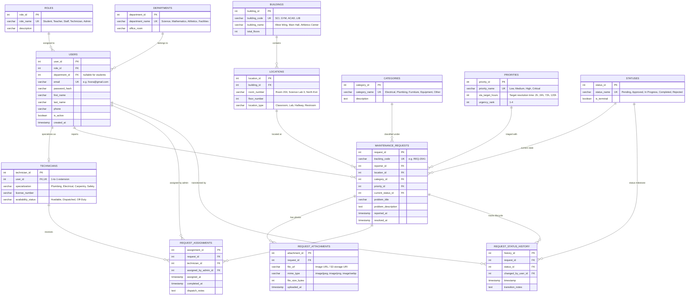

# Fixora — Relational Database Schema & ERD Specification

This document provides the complete Entity-Relationship Diagram (ERD), Database Normalization Analysis (1NF, 2NF, 3NF, BCNF), and the PostgreSQL / MySQL compatible DDL Schema for **Fixora — School Repair & Maintenance Management System**.

---

## 1. Entity-Relationship Diagram (ERD)



---

## 2. Normalization Step-by-Step Analysis

The database was engineered starting from a disorganized Unnormalized Form (UNF) through 1NF, 2NF, 3NF, and BCNF to ensure zero data redundancy, anomaly prevention, and referential integrity.

### A. Unnormalized Form (UNF)
In an unnormalized legacy spreadsheet or flat file:
```text
UNF_TICKET(
    request_id, problem_title, problem_description, 
    reporter_name, reporter_email, reporter_dept, reporter_role,
    building_name, room_number, building_floors,
    category_name, priority_name, priority_sla_hours,
    status_name,
    photo_url_1, photo_url_2, photo_url_3,
    technician_name, technician_specialization, technician_phone,
    assigned_admin_name, status_history_log
)
```
**Anomalies Present:**
* **Insertion Anomaly:** A new technician or building cannot be added without inventing a fictitious repair request.
* **Update Anomaly:** If a technician updates their phone number or a priority SLA changes, hundreds of historical rows must be modified.
* **Deletion Anomaly:** Deleting a resolved ticket removes the only record that a particular room or category exists.
* **Repeating Groups:** Multiple photo URLs and status transitions violate atomic storage.

---

### B. First Normal Form (1NF)
> **Rule:** Every attribute contains only atomic (indivisible) values. No repeating groups or arrays. Every table has a primary key.

1. **Eliminated Repeating Groups:**
   * Removed multiple photo columns (`photo_url_1`, `photo_url_2`) into a separate `REQUEST_ATTACHMENTS` entity with foreign key `request_id`.
   * Removed multi-valued status logs into a separate `REQUEST_STATUS_HISTORY` entity.
2. **Atomic Columns:**
   * Full names decomposed into `first_name` and `last_name`.
   * Location strings decomposed into `building_code`, `room_number`, and `floor_number`.
3. **Primary Keys:**
   * Defined surrogate primary keys (`user_id`, `request_id`, `location_id`, etc.) ensuring each tuple is uniquely identifiable.

---

### C. Second Normal Form (2NF)
> **Rule:** Must satisfy 1NF, and all non-key attributes must be fully functionally dependent on the primary key (no partial dependencies on composite keys).

1. In composite association tables (e.g., ticket-to-technician dispatch):
   * If we used composite key `(request_id, technician_id)` in a single table alongside `technician_specialization` and `technician_phone`, those technician attributes would depend only on `technician_id` (a subset of the primary key), violating 2NF.
2. **Resolution:**
   * Extracted `TECHNICIANS` into its own entity where `specialization`, `license_number`, and `availability_status` depend strictly on `technician_id`.
   * `REQUEST_ASSIGNMENTS` retains only the dispatch association: `request_id`, `technician_id`, `assigned_by_admin_id`, and `assigned_at`.

---

### D. Third Normal Form (3NF)
> **Rule:** Must satisfy 2NF, and no non-key attribute is transitively dependent on the primary key ($X \rightarrow Y$ and $Y \rightarrow Z$, therefore $X \rightarrow Z$).

1. **Building & Room Transitive Dependency:**
   * In `LOCATIONS`: `location_id -> room_number -> building_name -> total_floors`.
   * *Resolution:* Extracted `BUILDINGS` entity (`building_id`, `building_code`, `building_name`, `total_floors`). `LOCATIONS` now references `building_id` as a foreign key.
2. **User, Department, and Role Transitive Dependency:**
   * In `USERS`: `user_id -> department_name -> office_room` and `user_id -> role_name -> role_permissions`.
   * *Resolution:* Created lookup entities `DEPARTMENTS` and `ROLES`. `USERS` stores only foreign keys `department_id` and `role_id`.
3. **Priority & SLA Transitive Dependency:**
   * `request_id -> priority_name -> sla_target_hours`.
   * *Resolution:* Created `PRIORITIES` table. Ticket stores only `priority_id`.

---

### E. Boyce-Codd Normal Form (BCNF)
> **Rule:** For every functional dependency $X \rightarrow Y$, $X$ must be a superkey.

* In all finalized relations, every determinant is a candidate key (or primary key).
* Unique constraints (`UK`) are explicitly enforced on alternate keys:
  * `USERS(email)`
  * `BUILDINGS(building_code)`
  * `ROLES(role_name)`
  * `CATEGORIES(category_name)`
  * `PRIORITIES(priority_name)`
  * `STATUSES(status_name)`
  * `MAINTENANCE_REQUESTS(tracking_code)`

---

## 3. Relational Schema Data Dictionary

### Table 1: `ROLES`
Defines permission levels (Student, Teacher, Staff, Technician, Administrator).
| Column Name | Data Type | Constraints | Description |
| :--- | :--- | :--- | :--- |
| `role_id` | INT | PK, AUTO_INCREMENT | Unique role identifier |
| `role_name` | VARCHAR(50) | UNIQUE, NOT NULL | Role designation ('Student', 'Admin', etc.) |
| `description` | VARCHAR(255) | NULL | Scope of access |

### Table 2: `DEPARTMENTS`
School faculties and divisions.
| Column Name | Data Type | Constraints | Description |
| :--- | :--- | :--- | :--- |
| `department_id` | INT | PK, AUTO_INCREMENT | Unique department identifier |
| `department_name`| VARCHAR(100)| UNIQUE, NOT NULL | Name (e.g. 'Science Dept', 'Facilities') |
| `office_room` | VARCHAR(50) | NULL | Main department faculty office |

### Table 3: `USERS`
Authenticated system users and reporters.
| Column Name | Data Type | Constraints | Description |
| :--- | :--- | :--- | :--- |
| `user_id` | INT | PK, AUTO_INCREMENT | Unique user identifier |
| `role_id` | INT | FK -> `ROLES`, NOT NULL | User's security role |
| `department_id`| INT | FK -> `DEPARTMENTS`, NULL | User's academic/work department |
| `email` | VARCHAR(150)| UNIQUE, NOT NULL | Login email (e.g. `fixora@gmail.com`) |
| `password_hash`| VARCHAR(255)| NOT NULL | Secure salted bcrypt hash |
| `first_name` | VARCHAR(75) | NOT NULL | User's given name |
| `last_name` | VARCHAR(75) | NOT NULL | User's family name |
| `phone` | VARCHAR(25) | NULL | Contact phone / mobile |
| `is_active` | BOOLEAN | DEFAULT TRUE | Account state |
| `created_at` | TIMESTAMP | DEFAULT CURRENT_TIMESTAMP | Registration timestamp |

### Table 4: `TECHNICIANS`
Facilities staff dispatched to resolve maintenance issues (1-to-1 extension of USERS).
| Column Name | Data Type | Constraints | Description |
| :--- | :--- | :--- | :--- |
| `technician_id`| INT | PK, AUTO_INCREMENT | Unique technician profile ID |
| `user_id` | INT | FK -> `USERS`, UNIQUE, NOT NULL | Link to primary user profile |
| `specialization`| VARCHAR(100)| NOT NULL | Domain ('Plumbing', 'Electrical', 'Carpentry') |
| `license_number`| VARCHAR(50) | NULL | State or certified safety badge |
| `availability_status`| VARCHAR(30)| DEFAULT 'Available' | 'Available', 'Dispatched', 'Off-Duty' |

### Table 5: `BUILDINGS`
Campus physical infrastructure.
| Column Name | Data Type | Constraints | Description |
| :--- | :--- | :--- | :--- |
| `building_id` | INT | PK, AUTO_INCREMENT | Unique building identifier |
| `building_code`| VARCHAR(20) | UNIQUE, NOT NULL | Building code ('SCI', 'GYM', 'ACAD') |
| `building_name`| VARCHAR(100)| NOT NULL | Building full name |
| `total_floors` | INT | NOT NULL, CHECK (>0) | Number of levels |

### Table 6: `LOCATIONS`
Specific rooms, laboratories, and halls within buildings.
| Column Name | Data Type | Constraints | Description |
| :--- | :--- | :--- | :--- |
| `location_id` | INT | PK, AUTO_INCREMENT | Unique location identifier |
| `building_id` | INT | FK -> `BUILDINGS`, NOT NULL | Parent building |
| `room_number` | VARCHAR(50) | NOT NULL | Room identifier ('Lab 3', 'Room 204') |
| `floor_number` | INT | NOT NULL | Floor index (0 = Ground, 1, 2) |
| `location_type`| VARCHAR(50) | NOT NULL | 'Classroom', 'Laboratory', 'Corridor' |

### Table 7: `CATEGORIES`
Classifications of maintenance problems.
| Column Name | Data Type | Constraints | Description |
| :--- | :--- | :--- | :--- |
| `category_id` | INT | PK, AUTO_INCREMENT | Unique category identifier |
| `category_name`| VARCHAR(50) | UNIQUE, NOT NULL | 'Electrical', 'Plumbing', 'Furniture', etc. |
| `description` | TEXT | NULL | Category scope |

### Table 8: `PRIORITIES`
SLA triage levels.
| Column Name | Data Type | Constraints | Description |
| :--- | :--- | :--- | :--- |
| `priority_id` | INT | PK, AUTO_INCREMENT | Unique priority identifier |
| `priority_name`| VARCHAR(30) | UNIQUE, NOT NULL | 'Low', 'Medium', 'High', 'Critical' |
| `sla_target_hours`| INT | NOT NULL | Response window in hours (2, 24, 72, 120) |
| `urgency_rank` | INT | NOT NULL | Sort ordering rank (1=Low, 4=Critical) |

### Table 9: `STATUSES`
Lifecycle milestones.
| Column Name | Data Type | Constraints | Description |
| :--- | :--- | :--- | :--- |
| `status_id` | INT | PK, AUTO_INCREMENT | Unique status identifier |
| `status_name` | VARCHAR(30) | UNIQUE, NOT NULL | 'Pending', 'Approved', 'In Progress', 'Completed' |
| `is_terminal` | BOOLEAN | DEFAULT FALSE | True if completed or closed |

### Table 10: `MAINTENANCE_REQUESTS`
Core maintenance order record.
| Column Name | Data Type | Constraints | Description |
| :--- | :--- | :--- | :--- |
| `request_id` | INT | PK, AUTO_INCREMENT | Internal primary key |
| `tracking_code`| VARCHAR(20) | UNIQUE, NOT NULL | Human-readable code (`REQ-2041`) |
| `reporter_id` | INT | FK -> `USERS`, NOT NULL | Person who logged the problem |
| `location_id` | INT | FK -> `LOCATIONS`, NOT NULL| Specific room/hallway |
| `category_id` | INT | FK -> `CATEGORIES`, NOT NULL| Repair category |
| `priority_id` | INT | FK -> `PRIORITIES`, NOT NULL| Urgency triage level |
| `current_status_id`| INT | FK -> `STATUSES`, NOT NULL | Active workflow milestone |
| `problem_title`| VARCHAR(200)| NOT NULL | Concise headline summary |
| `problem_description`| TEXT | NOT NULL | Full observation & symptoms |
| `reported_at` | TIMESTAMP | DEFAULT CURRENT_TIMESTAMP | Submission timestamp |
| `resolved_at` | TIMESTAMP | NULL | Date/time closed out |

### Table 11: `REQUEST_ATTACHMENTS`
Photo uploads and supporting files.
| Column Name | Data Type | Constraints | Description |
| :--- | :--- | :--- | :--- |
| `attachment_id`| INT | PK, AUTO_INCREMENT | Unique attachment identifier |
| `request_id` | INT | FK -> `MAINTENANCE_REQUESTS` | Linked repair ticket |
| `file_url` | VARCHAR(500)| NOT NULL | File URI / CDN path |
| `mime_type` | VARCHAR(50) | NOT NULL | Image format ('image/jpeg', etc.) |
| `file_size_bytes`| INT | NOT NULL | File payload size |
| `uploaded_at` | TIMESTAMP | DEFAULT CURRENT_TIMESTAMP | Upload timestamp |

### Table 12: `REQUEST_ASSIGNMENTS`
Dispatch assignments linking requests to certified technicians.
| Column Name | Data Type | Constraints | Description |
| :--- | :--- | :--- | :--- |
| `assignment_id`| INT | PK, AUTO_INCREMENT | Unique assignment record |
| `request_id` | INT | FK -> `MAINTENANCE_REQUESTS` | Dispatched ticket |
| `technician_id`| INT | FK -> `TECHNICIANS` | Assigned technician |
| `assigned_by_admin_id`| INT | FK -> `USERS` | Admin who authorized dispatch |
| `assigned_at` | TIMESTAMP | DEFAULT CURRENT_TIMESTAMP | Time assigned |
| `completed_at` | TIMESTAMP | NULL | Technician sign-off time |
| `dispatch_notes`| TEXT | NULL | Special instructions |

### Table 13: `REQUEST_STATUS_HISTORY`
Immutable audit log of all status transitions.
| Column Name | Data Type | Constraints | Description |
| :--- | :--- | :--- | :--- |
| `history_id` | INT | PK, AUTO_INCREMENT | Unique audit entry |
| `request_id` | INT | FK -> `MAINTENANCE_REQUESTS` | Ticket affected |
| `status_id` | INT | FK -> `STATUSES` | Transitioned status |
| `changed_by_user_id`| INT | FK -> `USERS` | Actor making the change |
| `timestamp` | TIMESTAMP | DEFAULT CURRENT_TIMESTAMP | Change timestamp |
| `transition_notes`| TEXT | NULL | Remarks or approval reason |

---

## 4. Production SQL DDL (PostgreSQL / MySQL Compatible)

```sql
-- Fixora Database Schema DDL
-- Compliant with 1NF, 2NF, 3NF, and BCNF

-- 1. Roles Table
CREATE TABLE roles (
    role_id INT GENERATED ALWAYS AS IDENTITY PRIMARY KEY,
    role_name VARCHAR(50) UNIQUE NOT NULL,
    description VARCHAR(255)
);

-- 2. Departments Table
CREATE TABLE departments (
    department_id INT GENERATED ALWAYS AS IDENTITY PRIMARY KEY,
    department_name VARCHAR(100) UNIQUE NOT NULL,
    office_room VARCHAR(50)
);

-- 3. Users Table
CREATE TABLE users (
    user_id INT GENERATED ALWAYS AS IDENTITY PRIMARY KEY,
    role_id INT NOT NULL REFERENCES roles(role_id) ON DELETE RESTRICT,
    department_id INT REFERENCES departments(department_id) ON DELETE SET NULL,
    email VARCHAR(150) UNIQUE NOT NULL,
    password_hash VARCHAR(255) NOT NULL,
    first_name VARCHAR(75) NOT NULL,
    last_name VARCHAR(75) NOT NULL,
    phone VARCHAR(25),
    is_active BOOLEAN DEFAULT TRUE,
    created_at TIMESTAMP WITH TIME ZONE DEFAULT CURRENT_TIMESTAMP
);

-- 4. Technicians Profile (1-to-1 with Users)
CREATE TABLE technicians (
    technician_id INT GENERATED ALWAYS AS IDENTITY PRIMARY KEY,
    user_id INT UNIQUE NOT NULL REFERENCES users(user_id) ON DELETE CASCADE,
    specialization VARCHAR(100) NOT NULL,
    license_number VARCHAR(50),
    availability_status VARCHAR(30) DEFAULT 'Available'
);

-- 5. Buildings Table
CREATE TABLE buildings (
    building_id INT GENERATED ALWAYS AS IDENTITY PRIMARY KEY,
    building_code VARCHAR(20) UNIQUE NOT NULL,
    building_name VARCHAR(100) NOT NULL,
    total_floors INT NOT NULL CHECK (total_floors > 0)
);

-- 6. Locations / Classrooms Table
CREATE TABLE locations (
    location_id INT GENERATED ALWAYS AS IDENTITY PRIMARY KEY,
    building_id INT NOT NULL REFERENCES buildings(building_id) ON DELETE CASCADE,
    room_number VARCHAR(50) NOT NULL,
    floor_number INT NOT NULL,
    location_type VARCHAR(50) NOT NULL,
    CONSTRAINT uq_building_room UNIQUE (building_id, room_number)
);

-- 7. Categories Table
CREATE TABLE categories (
    category_id INT GENERATED ALWAYS AS IDENTITY PRIMARY KEY,
    category_name VARCHAR(50) UNIQUE NOT NULL,
    description TEXT
);

-- 8. Priorities Table
CREATE TABLE priorities (
    priority_id INT GENERATED ALWAYS AS IDENTITY PRIMARY KEY,
    priority_name VARCHAR(30) UNIQUE NOT NULL,
    sla_target_hours INT NOT NULL CHECK (sla_target_hours > 0),
    urgency_rank INT NOT NULL UNIQUE
);

-- 9. Statuses Table
CREATE TABLE statuses (
    status_id INT GENERATED ALWAYS AS IDENTITY PRIMARY KEY,
    status_name VARCHAR(30) UNIQUE NOT NULL,
    is_terminal BOOLEAN DEFAULT FALSE
);

-- 10. Maintenance Requests Table
CREATE TABLE maintenance_requests (
    request_id INT GENERATED ALWAYS AS IDENTITY PRIMARY KEY,
    tracking_code VARCHAR(20) UNIQUE NOT NULL,
    reporter_id INT NOT NULL REFERENCES users(user_id) ON DELETE RESTRICT,
    location_id INT NOT NULL REFERENCES locations(location_id) ON DELETE RESTRICT,
    category_id INT NOT NULL REFERENCES categories(category_id) ON DELETE RESTRICT,
    priority_id INT NOT NULL REFERENCES priorities(priority_id) ON DELETE RESTRICT,
    current_status_id INT NOT NULL REFERENCES statuses(status_id) ON DELETE RESTRICT,
    problem_title VARCHAR(200) NOT NULL,
    problem_description TEXT NOT NULL,
    reported_at TIMESTAMP WITH TIME ZONE DEFAULT CURRENT_TIMESTAMP,
    resolved_at TIMESTAMP WITH TIME ZONE
);

-- 11. Request Attachments / Photos (1NF compliant)
CREATE TABLE request_attachments (
    attachment_id INT GENERATED ALWAYS AS IDENTITY PRIMARY KEY,
    request_id INT NOT NULL REFERENCES maintenance_requests(request_id) ON DELETE CASCADE,
    file_url VARCHAR(500) NOT NULL,
    mime_type VARCHAR(50) NOT NULL,
    file_size_bytes INT NOT NULL,
    uploaded_at TIMESTAMP WITH TIME ZONE DEFAULT CURRENT_TIMESTAMP
);

-- 12. Request Assignments (Dispatch linking)
CREATE TABLE request_assignments (
    assignment_id INT GENERATED ALWAYS AS IDENTITY PRIMARY KEY,
    request_id INT NOT NULL REFERENCES maintenance_requests(request_id) ON DELETE CASCADE,
    technician_id INT NOT NULL REFERENCES technicians(technician_id) ON DELETE RESTRICT,
    assigned_by_admin_id INT NOT NULL REFERENCES users(user_id) ON DELETE RESTRICT,
    assigned_at TIMESTAMP WITH TIME ZONE DEFAULT CURRENT_TIMESTAMP,
    completed_at TIMESTAMP WITH TIME ZONE,
    dispatch_notes TEXT
);

-- 13. Status Audit History (Audit trail)
CREATE TABLE request_status_history (
    history_id INT GENERATED ALWAYS AS IDENTITY PRIMARY KEY,
    request_id INT NOT NULL REFERENCES maintenance_requests(request_id) ON DELETE CASCADE,
    status_id INT NOT NULL REFERENCES statuses(status_id) ON DELETE RESTRICT,
    changed_by_user_id INT NOT NULL REFERENCES users(user_id) ON DELETE RESTRICT,
    timestamp TIMESTAMP WITH TIME ZONE DEFAULT CURRENT_TIMESTAMP,
    transition_notes TEXT
);

-- Performance Indexes
CREATE INDEX idx_requests_status ON maintenance_requests(current_status_id);
CREATE INDEX idx_requests_priority ON maintenance_requests(priority_id);
CREATE INDEX idx_requests_location ON maintenance_requests(location_id);
CREATE INDEX idx_requests_reporter ON maintenance_requests(reporter_id);
CREATE INDEX idx_assignments_technician ON request_assignments(technician_id);
CREATE INDEX idx_status_history_request ON request_status_history(request_id);
```
